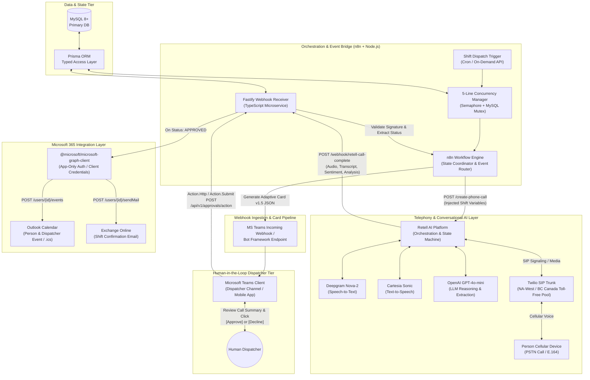
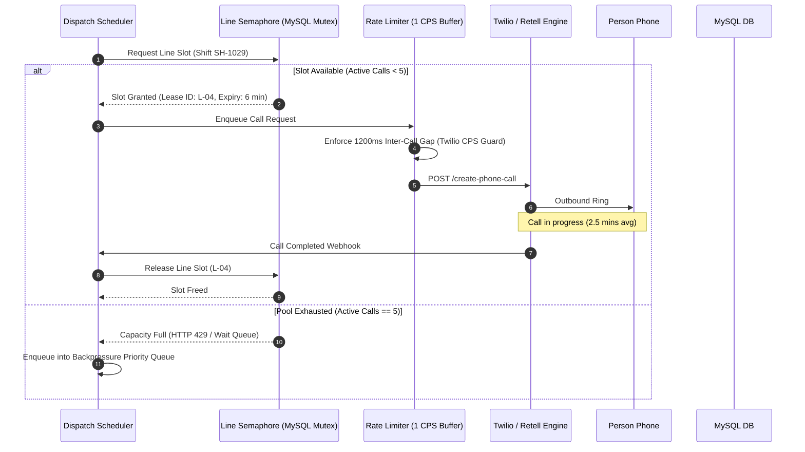

# 01. System Architecture Specification

## Dispatch & Scheduling Automation Agent (Human-in-the-Loop)

---

### 1. Executive Summary & Architectural Philosophy

The **Guardteck Security Dispatch & Scheduling Automation Agent** is an event-driven, human-in-the-loop microservices system engineered for 24/7 mission-critical security operations in British Columbia, Canada. It eliminates manual phone tag by autonomously executing outbound scheduling calls, capturing tentative person availability, and pushing structured approval cards to human dispatchers via Microsoft Teams.

#### Core Tenets & Operating Constraints
1. **Strict Human-in-the-Loop (HITL) Guarantee**: The voice agent (**Guardteck Dispatch Bot**) possesses **zero authority** to commit shifts. The agent gathers tentative acceptance, records preferences, and asserts: *"I've logged this preference for dispatch review."* Bookings are legally and operationally committed **only** after human dispatcher sign-off.
2. **Operational Scale & Throughput**:
   - Active capacity portfolio: **40,000 operational hours** (~5,000 eight-hour shifts).
   - Target daily throughput: **800 hours/day** (100 filled shifts) requiring **~100 outbound calls/day**.
   - Average call duration: **2.0 – 2.5 minutes**.
3. **Telephony Pool Concurrency**: Maximum of **5 simultaneous outbound toll-free lines** during dispatch surges (morning shift fill windows and emergency call-outs).
4. **Hard Cost Ceiling**: Daily compute, telephony, and API expenditure capped at **<$25.00/day** (baseline steady-state: **$14.00 – $18.60/day**).
5. **Lean, Non-Blocking Architecture**: Built on TypeScript / Node.js (v20+ LTS) using Fastify, Prisma ORM, MySQL 8+, Retell AI, Twilio SIP (NA-West / `us-west-2` edge for BC, Canada), n8n orchestrator, and Microsoft 365 Graph SDK.
---

### 2. High-Level End-to-End System Architecture



---

### 3. Component Registry

| Component | Technology | Primary Responsibility | Interface / Protocol | Scaling & Concurrency |
| :--- | :--- | :--- | :--- | :--- |
| **Persistence Store** | MySQL 8+ | System of record for Persons, Shifts, CallLogs, and ApprovalQueue | TCP 3306 / TLS; Connection pooling via Prisma | Max 20 connections; row-level locking for shift reservation |
| **ORM / Data Access** | Prisma Client (TS) | Strongly typed query builder, schema migration engine | Direct Node.js native bindings | Transactional isolation for shift state mutations |
| **Webhook Receiver & API** | Node.js 20 LTS + Fastify | Ingests Retell webhooks, validates signatures, processes dispatcher actions | HTTPS REST / Port 3000; Zod schema validation | Non-blocking event loop; ~300 req/sec per core |
| **Workflow Orchestrator** | n8n (Docker / Self-Hosted) | Visual state orchestration, dead-letter retries, Teams payload construction | Webhook triggers / Port 5678 / Redis queue | Handles transient failure retries and delay queues |
| **Voice AI Agent Platform** | Retell AI | Low-latency audio loop, turn-taking, prompt guardrails, post-call analysis | HTTPS REST API + WebSockets | Ingests dynamic context; guarantees <800ms response latency |
| **Speech-to-Text (STT)** | Deepgram Nova-2 | Real-time audio streaming transcription with filler word suppression | WebSocket streaming via Retell | Optimized for noisy environments and mobile/cellular calls |
| **Text-to-Speech (TTS)** | Cartesia Sonic | Ultra-low latency voice synthesis, human conversational inflection | WebSocket audio streaming via Retell | ~120ms first-byte TTS latency |
| **LLM Reasoning** | OpenAI GPT-4o-mini | Intent extraction, guardrail enforcement, dynamic FAQ lookup | Retell LLM connector | Low cost ($0.15/1M input, $0.60/1M output); strict JSON outputs |
| **Telephony Trunking** | Twilio Elastic SIP Trunking (`us-west-2` Oregon / Umatilla edge for BC, Canada) | Carrier PSTN interconnect, toll-free CLI pool, AMD detection | SIP / E.164 PSTN | Configured for 1 CPS rate ceiling across 5 concurrent toll-free channels |
| **Collaboration & HITL** | Microsoft Teams | Real-time dispatcher notification, interactive Adaptive Cards v1.5 | Incoming Webhook / Actionable Messages | Instant push to dispatch channel; audit trail in conversation |
| **Enterprise Calendar / Mail**| Microsoft Graph API SDK | Programmatic creation of calendar invites, .ics attachments, confirmation emails | HTTPS REST (Azure AD OAuth 2.0 Client Credentials) | Token caching with automatic refresh; exponential backoff on 429 |

---

### 4. Concurrency Management Strategy for 5 Parallel Toll-Free Lines

Guardteck Security dispatch operations experience acute spikes (e.g., 05:00–07:00 AM PST shift call-outs and 16:00–18:00 PM PST evening schedule adjustments). To protect caller reputation, comply with carrier policies, minimize toll/local number fees, and avoid overwhelming human dispatchers with simultaneous approvals, the telephony engine enforces a strict **5-Line Concurrent Toll-Free Execution Pool**.

#### 4.1 Architecture of the Semaphore Pool



#### 4.2 Rate Limiting & Calls-Per-Second (CPS) Pacing
- **Twilio CPS Ceiling**: Standard Twilio trunks provide 1 CPS out-of-the-box. Bursting 5 calls simultaneously will result in `Twilio Error 32003: Rate limit exceeded`.
- **Token Bucket Pacing**: The outbound dispatch engine uses an in-memory leaky token bucket with a capacity of 1 token and a refill rate of **1 token / 1,200 ms** (providing a 20% safety margin below 1 CPS). Even during a 5-line burst, calls are triggered with a staggered 1.2-second delay.

#### 4.3 Slot-Filled Mid-Burst Cancellation (Race Condition Mitigation)
In security dispatch, multiple people may be called simultaneously for the same high-priority critical shift, or a single person may call back dispatch directly while automated calls are ringing others.

1. **Shift Reservation Lock**: When a tentative acceptance is logged via webhook, the shift status transitions immediately to `PENDING_APPROVAL`, acquiring a distributed lock on `shift_id`.
2. **Automated Line Revocation**:
   - The system queries `CallLog` for any other active `CallLog.status IN ('INITIATED', 'RINGING')` referencing the same `shift_id`.
   - The engine issues immediate `POST https://api.retellai.com/v2/stop-phone-call/{call_id}` cancellations for all redundant ringing lines.
   - For calls already in `IN_PROGRESS` state, the agent's dynamic context receives an interrupt flag, smoothly prompting: *"Marcus, Guardteck Dispatch Bot just updated that this site shift was just taken, let me check if we have another shift opening up."*

#### 4.4 Distributed Semaphore Implementation Specification
The line pool uses a database-backed lease table (`ActiveLineLease`) with auto-reaping of stale leases:
```sql
-- Atomic Slot Acquisition Query (MySQL 8)
INSERT INTO ActiveLineLease (id, callId, shiftId, personId, channelIndex, acquiredAt, expiresAt)
SELECT UUID(), :callId, :shiftId, :personId, :channelIndex, NOW(), DATE_ADD(NOW(), INTERVAL 6 MINUTE)
WHERE (SELECT COUNT(*) FROM ActiveLineLease WHERE releasedAt IS NULL AND expiresAt > NOW()) < 5;
```
If zero rows are inserted, the system enqueues the person into a FIFO dispatch queue.

---

### 5. Fallback & Telephony Error Handling Matrix

| Scenario / Event | Detection Mechanism | Immediate System Action | State Mutation | Dispatcher / Person Visibility |
| :--- | :--- | :--- | :--- | :--- |
| **Voicemail / Answering Machine** | Twilio / Retell AMD flag (`machine_detected: true`) | Agent plays 15-second concise audio drop with callback phone number; disconnects immediately. | `CallLog.status = 'VOICEMAIL'`, `attemptCount += 1` | Teams notification suppressed; retry scheduled for +45 minutes (max 3 attempts). |
| **Unanswered / Ring Timeout** | Retell webhook status `no_answer` or call duration < 1s | Disconnect call; release line lease immediately. | `CallLog.status = 'NO_ANSWER'`, `attemptCount += 1` | Retry scheduled for +30 minutes; Person status unchanged. |
| **Mid-Call Carrier Drop / Hangup** | Webhook disconnect reason `person_hangup` before preference confirmed | Determine conversation progress. If dropped mid-confirmation, flag for review. | `CallLog.status = 'ABANDONED'` | If dropped within 30s of start: retry once after 15 min. If after details given: alert dispatcher. |
| **Person Declines Shift** | LLM extracts `outcome_code: "DECLINE"` | Agent politely thanks person, confirms decline, ends call in under 15 seconds. | `CallLog.outcome = 'DECLINED'`, `ShiftAssignment.status = 'DECLINED'` | Logged in DB; shift returned to pool for next ranked person. No Teams approval generated. |
| **Double-Booking Contention** | Simultaneous tentative acceptance for same shift | Database optimistic concurrency control (`version` column check). | Second person marked `CONTENDED_BACKUP` | Teams card shows: `CONTENDED SLOT: Another person also accepted. Choose primary person.` |
| **Hostile Caller / DNC Request** | LLM detects `outcome_code: "DNC_REQUEST"` or abusive sentiment | Agent immediately apologizes, confirms removal, ceases conversation: *"Understood, updating records."* | `Person.dncFlag = true`, `Person.status = 'INACTIVE'` | High-priority Teams alert to Safety/Compliance channel; phone blacklisted system-wide. |
| **Retell / Twilio Outage** | 5xx response from Retell API or circuit breaker trips | Fastify circuit breaker opens after 3 consecutive failures; fallback to manual queue. | `Shift.dispatchMode = 'MANUAL_DISPATCH'` | Emergency Teams alert: `Telephony Outage: 5-line pool paused. Switching shifts to manual dispatch.` |
| **MS Graph API Rate Limit (429)** | Microsoft Graph responds with HTTP 429 and `Retry-After` header | Microservice pauses Outlook requests; exponential backoff with jitter (max 5 retries). | `ApprovalQueue.status = 'APPROVED_PENDING_SYNC'` | Dispatcher sees "Approved — Calendar Sync in progress" pill on Teams Card. |

---

### 6. Event-Driven Architecture & Idempotency Guarantees

```mermaid
flowchart LR
    A[Twilio PSTN] -->|RTP / SIP| B[Retell AI]
    B -->|Webhook: call_analyzed| C[Fastify Ingestion API]
    C -->|HMAC-SHA256 Auth| D{Signature Valid?}
    D -->|No| E[HTTP 401 Drop]
    D -->|Yes| F{Idempotency Key\nExists in DB?}
    F -->|Yes (Duplicate)| G[HTTP 200 Fast Return Cached]
    F -->|No| H[Write CallLog & Set Idempotency Key]
    H --> I{Outcome ==\nTENTATIVE_ACCEPT?}
    I -->|No| J[Update Shift / Schedule Retry]
    I -->|Yes| K[Create ApprovalQueue Row]
    K --> L[Dispatch Teams Adaptive Card]
```

#### Idempotency Strategy
- Every Retell call generates a unique deterministic UUID `call_id`.
- The Fastify ingestion endpoint executes:
  ```typescript
  const idempotencyKey = `retell:call:${payload.call_id}`;
  ```
- If a webhook retry arrives (due to network latency or Retell retry policy), the database row is checked. If the `call_id` is already in terminal state (`COMPLETED`), Fastify returns `200 OK` with `{ status: "already_processed" }` without re-posting duplicate Teams cards.

---

### 7. Security & Governance Architecture

1. **Webhook Integrity Verification**:
   - Inbound Retell webhooks validate the `X-Retell-Signature` HTTP header using HMAC-SHA256 computation against `RETELL_API_KEY`.
   - Teams Action endpoints validate the Microsoft HMAC token / JWT bearer claims to verify requests originate from the designated M365 tenant.
2. **Microsoft Graph Authentication**:
   - Azure Active Directory (Entra ID) App Registration utilizing **OAuth 2.0 Client Credentials Grant** (non-interactive daemon flow).
   - Scoped least-privilege permissions:
     - `Calendars.ReadWrite` (Application level, restricted to Guardteck Security mailboxes via Application Access Policies).
     - `Mail.Send` (Send confirmation emails from `dispatch@guardteck.com`).
3. **Database Security & Secrets**:
   - Zero hardcoded credentials; 100% sourced from environment variables with schema validation on startup via Zod.
   - SSL `require` mode enabled for MySQL connection strings in production.
   - Person PII (Phone numbers, names) encrypted at rest using AES-256-GCM.

---

### 8. Enterprise Cost Model Breakdown

Target: **Under $25.00/day** for an operational capacity of filling 80 hours/day (10 shifts) across ~100 outbound calls/day.

| Infrastructure Item | Unit Rate | Daily Consumption Profile | Daily Projected Cost |
| :--- | :--- | :--- | :--- |
| **Twilio Outbound PSTN Voice** | $0.0140 / minute | 100 calls × 2.5 min = 250 minutes | $3.50 |
| **Twilio Phone Numbers (Pool)** | $2.15 / month per toll-free number | 5 dedicated toll-free numbers ($10.75 / 30) | $0.36 |
| **Retell AI Platform Engine** | $0.0500 / minute | 100 calls × 2.5 min = 250 minutes | $12.50 |
| **Deepgram Nova-2 (STT)** | Included in Retell bundled rate | Bundled within Retell audio tier | $0.00 |
| **Cartesia Sonic (TTS)** | Included in Retell bundled rate | Bundled within Retell audio tier | $0.00 |
| **OpenAI GPT-4o-mini (LLM)** | $0.15/1M in, $0.60/1M out | ~1,200 tokens/call × 100 calls = 120k tokens | $0.05 |
| **MySQL & n8n Compute** | Self-hosted VPS / Docker instance | $20/month base cloud VM ($20 / 30) | $0.67 |
| **Microsoft 365 Graph API** | API calls included in M365 plan | 10 approved shifts = 20 Graph API calls | $0.00 |
| **Buffer / Overages / AMD Drops** | 20% contingency | Additional ringing & voicemail drops | $1.50 |
| **TOTAL PROJECTED DAILY RUN RATE**| — | **100 calls / 10 filled shifts per day** | **$18.58 / day** |

> **Cost Compliance Conclusion**: The projected run rate of **$18.58/day** operates safely within the **$25.00/day ceiling**, leaving a **$6.42/day (25.7%) safety margin** for surge days requiring up to 135 calls.

---

### 9. Deployment Topology & Environments

- **Development**: Docker Compose running MySQL 8, n8n, Fastify server with hot-reload, and `ngrok` tunnel for incoming Retell webhooks.
- **Staging / QA**: Containerized on internal Kubernetes or AWS ECS with simulated PSTN persons (SIP mock endpoints).
- **Production**: High-availability dual-region deployment with container auto-scaling (1–4 instances), managed MySQL (AWS RDS / Cloud SQL) with read-replicas, and external logging via Grafana/Prometheus + Sentry for error tracing.
