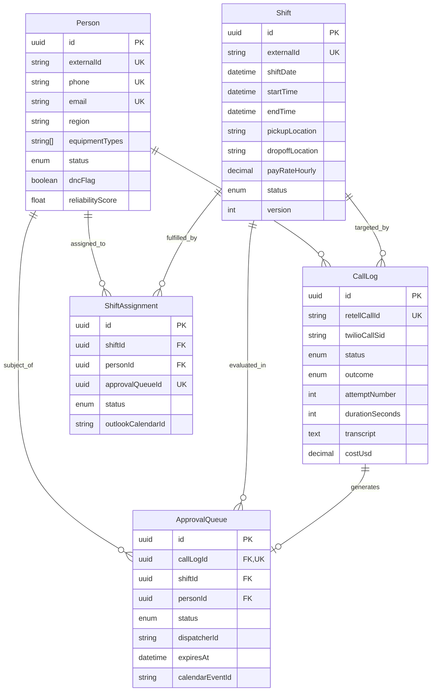

# 03. Data Models & Interface Schemas Specification

## MySQL 8 / Prisma ORM, Retell Webhooks, Adaptive Cards & MS Graph Schemas

---

### 1. Database Architecture & Design Standards

The data layer is modeled in MySQL 8.0+ via Prisma ORM with strict adherence to logistics industry data integrity:
- **Identifier Strategy**: UUID v4 for internal database primary keys; prefixed strings (e.g. `SH-2024-xxxx`, `PER-xxxx`) for human-readable external identifiers.
- **Audit Logging**: Every core state mutation captures `createdAt`, `updatedAt`, and the acting entity (`dispatcherId` or `system`).
- **Idempotency**: All incoming webhook events (Retell calls, Teams card actions) enforce unique constraint indexes to prevent replay or duplicate scheduling.
- **Timezone Discipline**: All database timestamps are persisted in **UTC (`timestamptz`)**. Conversions to local facility time zones (e.g., `America/Chicago`) occur during payload rendering.

---

### 2. Complete Prisma Schema (`schema.prisma`)

```prisma
datasource db {
  provider = "mysql"
  url      = env("DATABASE_URL")
}

generator client {
  provider = "prisma-client-js"
}

// -----------------------------------------------------------------------------
// ENUMS
// -----------------------------------------------------------------------------

enum PersonStatus {
  ACTIVE
  INACTIVE
  SUSPENDED
  DNC_DO_NOT_CALL
}

enum ShiftStatus {
  OPEN
  DISPATCH_IN_PROGRESS
  PENDING_DISPATCHER_APPROVAL
  ASSIGNED
  IN_PROGRESS
  COMPLETED
  CANCELLED
}

enum CallDirection {
  OUTBOUND
  INBOUND
}

enum CallStatus {
  SCHEDULED
  INITIATED
  RINGING
  IN_PROGRESS
  COMPLETED
  FAILED
  NO_ANSWER
  VOICEMAIL
  BUSY
}

enum CallOutcome {
  TENTATIVE_ACCEPT
  DECLINE
  CALLBACK_REQUESTED
  VOICEMAIL_LEFT
  NO_ANSWER
  DNC_REQUEST
  HOSTILE_ABUSIVE
  INCONCLUSIVE
  ERROR
}

enum ApprovalStatus {
  PENDING
  APPROVED
  DECLINED
  EXPIRED
  CANCELLED_BY_SYSTEM
}

enum AssignmentStatus {
  TENTATIVE
  CONFIRMED
  ACTIVE
  COMPLETED
  CANCELLED
}

// -----------------------------------------------------------------------------
// MODELS
// -----------------------------------------------------------------------------

model Person {
  id                    String        @id @default(uuid())
  externalId            String        @unique // e.g., "PER-1042"
  firstName             String
  lastName              String
  phone                 String        @unique // E.164 standard, e.g., "+12145550198"
  email                 String        @unique
  region                String        // Regional routing key: "DFW", "HOU", "AUS", "CHI"
  equipmentTypes        Json          // Stored as JSON array: ["53_DRY_VAN", "REEFER", "FLATBED"]
  status                PersonStatus  @default(ACTIVE)
  dncFlag               Boolean       @default(false)
  dncReason             String?
  dncTimestamp          DateTime?
  preferredContactStart String?       // "07:00"
  preferredContactEnd   String?       // "19:00"
  timezone              String        @default("America/Chicago")
  reliabilityScore      Float         @default(1.0) // 0.00 to 1.00
  totalShiftsCompleted  Int           @default(0)
  notes                 String?
  createdAt             DateTime      @default(now())
  updatedAt             DateTime      @updatedAt

  callLogs              CallLog[]
  approvals             ApprovalQueue[]
  assignments           ShiftAssignment[]

  @@index([region, status])
  @@index([phone])
}

model Shift {
  id                    String        @id @default(uuid())
  externalId            String        @unique // e.g., "SH-2024-8841"
  shiftDate             DateTime      // UTC start date
  startTime             DateTime      // UTC timestamp
  endTime               DateTime      // UTC timestamp
  durationHours         Float         // 8.0, 10.0
  pickupLocation        String        // e.g., "DFW South Yard, Dock 42"
  dropoffLocation       String        // e.g., "Austin Fulfillment Hub"
  equipmentType         String        // "53_DRY_VAN"
  payRateHourly         Decimal       @db.Decimal(10, 2) // e.g., 32.50
  currency              String        @default("USD")
  specialInstructions   String?
  priority              Int           @default(1) // 1=Normal, 2=Urgent, 3=Critical Emergency
  status                ShiftStatus   @default(OPEN)
  requiredCertifications Json         // Stored as JSON array
  version               Int           @default(1) // Optimistic locking
  createdAt             DateTime      @default(now())
  updatedAt             DateTime      @updatedAt

  callLogs              CallLog[]
  approvals             ApprovalQueue[]
  assignments           ShiftAssignment[]

  @@index([status, shiftDate])
  @@index([priority, status])
}

model CallLog {
  id                    String        @id @default(uuid())
  shiftId               String
  personId              String
  retellCallId          String        @unique // Retell call identifier
  twilioCallSid         String?       @unique // Twilio Call SID
  direction             CallDirection @default(OUTBOUND)
  status                CallStatus    @default(INITIATED)
  outcome               CallOutcome?
  attemptNumber         Int           @default(1)
  maxAttempts           Int           @default(3)
  startedAt             DateTime?
  endedAt               DateTime?
  durationSeconds       Int           @default(0)
  recordingUrl          String?
  transcript            String?       @db.Text
  sentimentScore        Float?        // -1.0 to +1.0
  summary               String?       @db.Text
  personFeedbackNotes   String?       @db.Text
  costUsd               Decimal?      @db.Decimal(6, 4) // Telephony + LLM cost
  createdAt             DateTime      @default(now())

  shift                 Shift         @relation(fields: [shiftId], references: [id], onDelete: Cascade)
  person                Person        @relation(fields: [personId], references: [id], onDelete: Cascade)
  approval              ApprovalQueue?

  @@index([shiftId, status])
  @@index([personId, createdAt])
}

model ApprovalQueue {
  id                    String         @id @default(uuid())
  callLogId             String         @unique
  shiftId               String
  personId              String
  status                ApprovalStatus @default(PENDING)
  teamsMessageId        String?        // ID of posted Adaptive Card message
  teamsCardPayload      Json?          // Snapshot of dispatched card JSON
  dispatcherId          String?        // Identity of human dispatcher (UPN / email)
  dispatcherName        String?        // e.g., "Sarah Jenkins"
  dispatcherNotes       String?
  actionTimestamp       DateTime?
  expiresAt             DateTime       // Auto-expiry timestamp (e.g. 30 mins)
  calendarEventId       String?        // MS Graph Event ID upon approval
  emailMessageId        String?        // MS Graph Sent Mail ID
  createdAt             DateTime       @default(now())
  updatedAt             DateTime       @updatedAt

  callLog               CallLog        @relation(fields: [callLogId], references: [id], onDelete: Cascade)
  shift                 Shift          @relation(fields: [shiftId], references: [id], onDelete: Cascade)
  person                Person         @relation(fields: [personId], references: [id], onDelete: Cascade)

  @@index([status, expiresAt])
}

model ShiftAssignment {
  id                    String           @id @default(uuid())
  shiftId               String
  personId              String
  approvalQueueId       String           @unique
  status                AssignmentStatus @default(CONFIRMED)
  confirmedAt           DateTime         @default(now())
  outlookCalendarId     String?
  icsUid                String?
  createdAt             DateTime         @default(now())
  updatedAt             DateTime         @updatedAt

  shift                 Shift            @relation(fields: [shiftId], references: [id], onDelete: Restrict)
  person                Person           @relation(fields: [personId], references: [id], onDelete: Restrict)

  @@unique([shiftId, personId])
  @@index([personId, status])
}

model ActiveLineLease {
  id                    String        @id @default(uuid())
  callId                String        @unique
  shiftId               String
  personId              String
  channelIndex          Int           // 1 through 7
  acquiredAt            DateTime      @default(now())
  expiresAt             DateTime      // Absolute TTL (e.g. 6 mins)
  releasedAt            DateTime?

  @@index([releasedAt, expiresAt])
}
```

---

### 3. Entity-Relationship Diagram



---

### 4. Retell Call-Completion Webhook Payload Specification

When an outbound call completes, Retell AI posts a signed JSON payload to `https://api.dispatch.logistics-corp.com/webhook/retell-call-complete`.

```json
{
  "event": "call_analyzed",
  "call_id": "call_9841f3e72089a42cb901",
  "agent_id": "agent_apex_logistics_v1",
  "call_type": "phone_call",
  "from_number": "+12145550101",
  "to_number": "+12145550198",
  "call_status": "registered",
  "start_timestamp": 1730680800000,
  "end_timestamp": 1730680902000,
  "duration_ms": 102000,
  "disconnection_reason": "agent_hangup",
  "recording_url": "https://api.retellai.com/recordings/call_9841f3e72089a42cb901.wav",
  "public_log_url": "https://dashboard.retellai.com/call/call_9841f3e72089a42cb901",
  "retell_llm_dynamic_variables": {
    "shift_id": "SH-2024-8841",
    "person_id": "PER-1092",
    "person_name": "Marcus Vance",
    "person_first_name": "Marcus",
    "shift_date": "Wednesday, November 5th",
    "start_time": "6:00 AM Central",
    "end_time": "2:30 PM Central",
    "shift_duration_hours": 8,
    "pickup_location": "DFW South Yard, Dock 42",
    "dropoff_location": "Austin Fulfillment Hub",
    "equipment_type": "53-foot Dry Van, Drop and Hook",
    "pay_rate": "$32.50 per hour",
    "dispatch_desk_phone": "+18885550199"
  },
  "transcript": [
    {
      "role": "agent",
      "content": "Hi, is this Marcus?",
      "words": [{"word": "Hi", "start": 0.1, "end": 0.3}, {"word": "Marcus", "start": 0.4, "end": 0.8}]
    },
    {
      "role": "user",
      "content": "Yeah, speaking. Who's this?",
      "words": [{"word": "Yeah", "start": 1.1, "end": 1.4}, {"word": "speaking", "start": 1.5, "end": 1.9}]
    },
    {
      "role": "agent",
      "content": "Hi Marcus, this is Alex with Apex Logistics automated dispatch. We have an 8-hour shift tomorrow starting at 6:00 AM out of DFW South Yard delivering to Austin Hub at $32.50 per hour. Are you open to taking this run?",
      "words": []
    },
    {
      "role": "user",
      "content": "Yeah, put me down for it. I can run that tomorrow morning.",
      "words": []
    },
    {
      "role": "agent",
      "content": "Excellent! Thank you, Marcus. I have logged your tentative interest and submitted this to our human dispatch team for final review and approval. You will receive an official confirmation via email and calendar invite once approved. Have a great day and take care!",
      "words": []
    }
  ],
  "call_analysis": {
    "call_summary": "Agent Alex contacted Marcus Vance regarding shift SH-2024-8841 (DFW to Austin, 8 hrs at $32.50/hr). Person tentatively accepted the route. Agent confirmed human-in-the-loop dispatch review and concluded call.",
    "user_sentiment": "Positive",
    "call_successful": true,
    "in_voicemail": false,
    "custom_analysis_data": {
      "outcome_code": "TENTATIVE_ACCEPT",
      "tentative_acceptance": true,
      "person_notes": "Person asked no questions and expressed clear readiness for tomorrow morning run.",
      "follow_up_required": false
    }
  }
}
```

---

### 5. Microsoft Teams Adaptive Card v1.5 JSON Template

When `outcome_code == 'TENTATIVE_ACCEPT'`, the orchestrator formats and dispatches the following interactive card to the `#dispatch-approvals` Teams channel:

```json
{
  "$schema": "http://adaptivecards.io/schemas/adaptive-card.json",
  "type": "AdaptiveCard",
  "version": "1.5",
  "header": {
    "type": "Container",
    "items": [
      {
        "type": "ColumnSet",
        "columns": [
          {
            "type": "Column",
            "width": "auto",
            "items": [
              {
                "type": "Image",
                "url": "https://img.icons8.com/color/96/delivery.png",
                "size": "Medium"
              }
            ]
          },
          {
            "type": "Column",
            "width": "stretch",
            "items": [
              {
                "type": "TextBlock",
                "text": "DISPATCH APPROVAL REQUIRED",
                "weight": "Bolder",
                "size": "Large",
                "color": "Attention"
              },
              {
                "type": "TextBlock",
                "text": "Shift: ${shift_external_id} | Person: ${person_name}",
                "isSubtle": true,
                "spacing": "None"
              }
            ]
          }
        ]
      }
    ]
  },
  "body": [
    {
      "type": "Container",
      "style": "emphasis",
      "items": [
        {
          "type": "FactSet",
          "facts": [
            { "title": "Person:", "value": "${person_name} (${person_phone})" },
            { "title": "Reliability:", "value": "${reliability_score} ( ${shifts_completed} completed)" },
            { "title": "Route:", "value": "${pickup_location}  ${dropoff_location}" },
            { "title": "Schedule:", "value": "${shift_date} @ ${start_time} - ${end_time} (${duration_hours} hrs)" },
            { "title": "Equipment:", "value": "${equipment_type}" },
            { "title": "Pay Rate:", "value": "${pay_rate_hourly}/hr (Est. Total: ${total_pay})" }
          ]
        }
      ]
    },
    {
      "type": "Container",
      "items": [
        {
          "type": "TextBlock",
          "text": " AI Voice Call Summary",
          "weight": "Bolder",
          "size": "Medium"
        },
        {
          "type": "TextBlock",
          "text": "${ai_call_summary}",
          "wrap": true
        },
        {
          "type": "TextBlock",
          "text": "Call Duration: ${call_duration_seconds}s | Sentiment: ${sentiment}",
          "isSubtle": true,
          "size": "Small"
        }
      ]
    },
    {
      "type": "ActionSet",
      "actions": [
        {
          "type": "Action.ShowCard",
          "title": " View Transcript",
          "card": {
            "type": "AdaptiveCard",
            "body": [
              {
                "type": "TextBlock",
                "text": "${call_transcript_excerpt}",
                "wrap": true,
                "fontType": "Monospace",
                "size": "Small"
              }
            ]
          }
        }
      ]
    },
    {
      "type": "TextBlock",
      "text": " Approval window closes at ${expiry_timestamp} (20 mins remaining).",
      "color": "Warning",
      "size": "Small",
      "weight": "Bolder"
    }
  ],
  "actions": [
    {
      "type": "Action.Execute",
      "title": " Approve & Book Shift",
      "style": "positive",
      "verb": "approve_shift",
      "data": {
        "action": "APPROVE",
        "approvalQueueId": "${approval_queue_id}",
        "shiftId": "${shift_id}",
        "personId": "${person_id}",
        "shiftExternalId": "${shift_external_id}"
      }
    },
    {
      "type": "Action.Execute",
      "title": " Decline",
      "style": "destructive",
      "verb": "decline_shift",
      "data": {
        "action": "DECLINE",
        "approvalQueueId": "${approval_queue_id}",
        "shiftId": "${shift_id}",
        "personId": "${person_id}"
      }
    },
    {
      "type": "Action.OpenUrl",
      "title": " Listen Audio",
      "url": "${recording_url}"
    }
  ]
}
```

---

### 6. Microsoft Graph API Outlook Payloads

#### 6.1 Create Calendar Event (`POST /v1.0/users/{dispatcher-upn}/events`)
Sent via `@microsoft/microsoft-graph-client` upon human dispatcher approval:

```json
{
  "subject": "ASSIGNED ROUTE: Shift SH-2024-8841 (DFW to Austin)",
  "body": {
    "contentType": "HTML",
    "content": "<html><body><h2>Apex Logistics Shift Confirmation</h2><p>Dear Marcus,</p><p>Your shift assignment has been <strong>APPROVED</strong> by dispatch.</p><table border='1' cellpadding='8' style='border-collapse:collapse;'><tr><td><strong>Shift ID</strong></td><td>SH-2024-8841</td></tr><tr><td><strong>Date</strong></td><td>Wednesday, November 5th, 2024</td></tr><tr><td><strong>Reporting Time</strong></td><td>06:00 AM Central Time</td></tr><tr><td><strong>Pickup Dock</strong></td><td>DFW South Yard, Dock 42</td></tr><tr><td><strong>Destination</strong></td><td>Austin Fulfillment Hub</td></tr><tr><td><strong>Equipment</strong></td><td>53' Dry Van (Drop and Hook)</td></tr><tr><td><strong>Rate</strong></td><td>$32.50 / hour</td></tr></table><p><strong>Instructions:</strong> Steel-toe boots and high-visibility vest required. Pre-trip inspection sheet must be submitted via mobile portal before gate departure.</p><p>Dispatch Line: (888) 555-0199</p></body></html>"
  },
  "start": {
    "dateTime": "2024-11-05T06:00:00",
    "timeZone": "Central Standard Time"
  },
  "end": {
    "dateTime": "2024-11-05T14:30:00",
    "timeZone": "Central Standard Time"
  },
  "location": {
    "displayName": "DFW South Yard, Dock 42",
    "address": {
      "street": "1400 Logistics Pkwy",
      "city": "Fort Worth",
      "state": "TX",
      "postalCode": "76155",
      "countryOrRegion": "USA"
    }
  },
  "attendees": [
    {
      "emailAddress": {
        "address": "marcus.vance@apexlogistics.com",
        "name": "Marcus Vance"
      },
      "type": "required"
    },
    {
      "emailAddress": {
        "address": "dispatch@apexlogistics.com",
        "name": "Central Dispatch Operations"
      },
      "type": "optional"
    }
  ],
  "isReminderOn": true,
  "reminderMinutesBeforeStart": 120,
  "categories": ["Dispatch Confirmed", "Logistics Shift"],
  "responseRequested": true
}
```

#### 6.2 Confirmation Email (`POST /v1.0/users/{dispatcher-upn}/sendMail`)
```json
{
  "message": {
    "subject": "CONFIRMED: Your Route Sheet & Calendar Invite for Shift SH-2024-8841",
    "body": {
      "contentType": "HTML",
      "content": "<p>Marcus, your tentative acceptance for tomorrow's run has been officially approved by Dispatch. Please review the attached calendar invite and arrive at DFW South Yard by 05:45 AM.</p>"
    },
    "toRecipients": [
      {
        "emailAddress": {
          "address": "marcus.vance@apexlogistics.com"
        }
      }
    ],
    "importance": "high"
  },
  "saveToSentItems": true
}
```

---

### 7. Zod TypeScript Validation Schemas

Located in `src/schemas/index.ts`, these schemas enforce 100% runtime type-safety:

```typescript
import { z } from "zod";

// -----------------------------------------------------------------------------
// RETELL CALL-COMPLETION WEBHOOK VALIDATION
// -----------------------------------------------------------------------------

export const RetellWebhookEventSchema = z.object({
  event: z.enum(["call_started", "call_ended", "call_analyzed"]),
  call_id: z.string().min(5),
  agent_id: z.string(),
  call_type: z.enum(["phone_call", "web_call"]),
  from_number: z.string(),
  to_number: z.string(),
  call_status: z.string(),
  start_timestamp: z.number().int().positive(),
  end_timestamp: z.number().int().positive(),
  duration_ms: z.number().int().nonnegative(),
  disconnection_reason: z.string(),
  recording_url: z.string().url().optional(),
  retell_llm_dynamic_variables: z.object({
    shift_id: z.string(),
    person_id: z.string(),
    person_name: z.string(),
    person_first_name: z.string(),
    shift_date: z.string(),
    start_time: z.string(),
    end_time: z.string(),
    shift_duration_hours: z.coerce.number(),
    pickup_location: z.string(),
    dropoff_location: z.string(),
    equipment_type: z.string(),
    pay_rate: z.string(),
    dispatch_desk_phone: z.string().optional()
  }),
  transcript: z.array(
    z.object({
      role: z.enum(["agent", "user"]),
      content: z.string()
    })
  ).optional(),
  call_analysis: z.object({
    call_summary: z.string(),
    user_sentiment: z.string(),
    call_successful: z.boolean(),
    in_voicemail: z.boolean().optional(),
    custom_analysis_data: z.object({
      outcome_code: z.enum([
        "TENTATIVE_ACCEPT",
        "DECLINE",
        "CALLBACK_REQUESTED",
        "VOICEMAIL_LEFT",
        "NO_ANSWER",
        "DNC_REQUEST",
        "HOSTILE_ABUSIVE",
        "INCONCLUSIVE",
        "ERROR"
      ]),
      tentative_acceptance: z.boolean(),
      person_notes: z.string().optional()
    })
  })
});

export type RetellWebhookEvent = z.infer<typeof RetellWebhookEventSchema>;

// -----------------------------------------------------------------------------
// TEAMS ACTION SUBMIT SCHEMA
// -----------------------------------------------------------------------------

export const TeamsApprovalActionSchema = z.object({
  action: z.enum(["APPROVE", "DECLINE"]),
  approvalQueueId: z.string().uuid(),
  shiftId: z.string().uuid(),
  personId: z.string().uuid(),
  dispatcherId: z.string().min(3),
  dispatcherName: z.string().min(2),
  notes: z.string().optional()
});

export type TeamsApprovalAction = z.infer<typeof TeamsApprovalActionSchema>;
```

---

### 8. Database Migration & Rollback Strategy

1. **Prisma Migrations Workflow**:
   - Every schema change is generated via `npx prisma migrate dev --name <descriptive_slug>`.
   - Production migrations execute via `npx prisma migrate deploy` in container startup probes.
2. **Zero-Downtime Rollback Strategy**:
   - Destructive column removals are phased: Step 1 = deprecate in code; Step 2 = make column nullable; Step 3 = remove after 1 release cycle.
   - Database rollback scripts are stored alongside migration files as plain `.sql` down-scripts.
